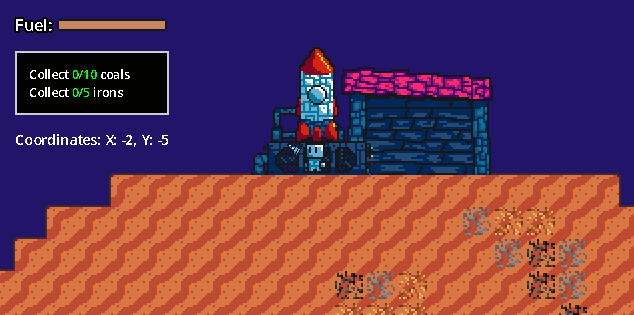

<!-- Ad Maiorem Dei Gloriam! -->
# A-Journey-Of-A-Robot
A 2D Game about mining on a planet while managing the planet stability



## About
The game is made on the Godot Engine tool and is about mining on a planet. The project is on early stage, so no many features are implemented by now.
This was made by 2 friends for Hackclub Thirdspace.

## How to run
Go to the itch.io page https://huntorbehunted83.itch.io/journey-of-a-robot and play it directly on your browser! Optionally, you can build it from source [right here](#build-from-source)

## Mechanics
The main game mechanic is mining. The player have a drill and has to mine some ores.
- The user can mine ores!
- (almost) Modular inventory system with godot resources
- Block Placing system
- Scrollable tech tree system
- Crafting system
- Building system
- Ore smelting system
- Main Base
	- Stack based menu
- Quest system based on scripts (not the most modular)
- Dialogue system (still not implemented)

## Build from source
You can download the github source code as a ZIP, unzip it and import on the Godot Game Engine. Alternativelly, you can use git:
```bash
git clone https://github.com/Renan-G-Projec/A-Journey-Of-A-Robot.git
```
and then open on Godot.

## Input mapping
- The input mapping is the following:
- D / Right -> Goes right
- A / Left -> Goes left
- S / Down -> Opens the blocks selection menu
- E -> Interacts with special elements (such as machines and the main base)
- Space -> Activates the jetpack
- Click -> Mines the ores
- Right-click -> Places the blocks (selected by clicking to go down)

## Notes
- The Machine input panel is unaligned. It will be fixed next week.
- The building system (not the block placing, but building machines and placing on the map) is not complete yet.

## Showcase
Here are some screenshots of the systems (in development!)
There are MUCH more.

- Tech tree
[TechTree](.github/public/screenshots/techtree.png)
- Crafting system
[Crafting](.github/public/screenshots/crafting.png)
- Block placing
[PlacingBlocks](.github/public/screenshots/placing_blocks.png)


## Future plans
The game isn't complete yet. The next features are planned:
- [] Add a interact popup when the player gets near interactables
- [] Add more machines
- [] Rework the dialogue system
- [] Add more upgrades to the tech tree
- [] Add more craftings
- [] Improve the juice of the building system
- [] Fix typos along the codebase and make the overall code more legible
- [] Add more layers (3/7)


## AI Usage declaration
AI was used only in very specific causes. The only piece of code generated by it was the function update_terrain_area_sliced to improve performance to an acceptable level. Some good practice questions were made to learn more Godot. (eg. Should this be a chain of signals or an autoload? Which can be more decoupled?)
None art assets or sound effects were made with AI. 

## Credits
- Background Music - BonoboGames - Space Background Music (2020) - CC-BY 3.0
